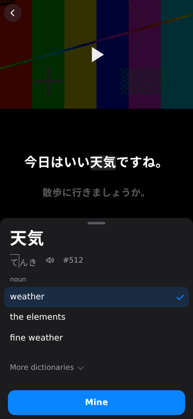
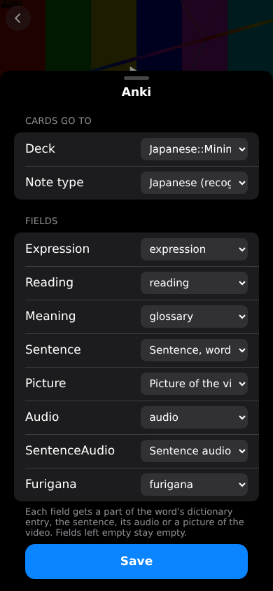

# Shisu-ko

[](https://github.com/Multysquid/shisu-ko/actions/workflows/tests.yml)

Live Japanese subtitles for YouTube in Firefox and Chrome: transcribed on your own machine by Whisper,
readable with [Yomitan](https://yomitan.wiki/), and mined into Anki without pressing a key.


Hover a line and the video waits. Look the word up, add the card, and Shisu-ko fills it with the
frame you were reading and the audio of the sentence. The same recording
[with sound](docs/demo.mp4).

YouTube's Japanese captions are often missing, wrong, or burned into the picture where no
dictionary can reach them. Shisu-ko makes its own. A server on your computer runs OpenAI's
Whisper on your GPU, a little ahead of where you are watching. The extension draws each line over
the player as ordinary text, so your dictionary can read it.

Shisu-ko has two parts: the browser extension and that server. The extension does nothing until
the server runs, so installing starts with the server. Both run on your own computer; see
[Privacy](#privacy) for what goes online.

**[Install](#install)** · [Using it](#using-shisu-ko) · [Sentence mining](#sentence-mining) ·
[Word colours](#word-colours) · [Phone portal](#phone-portal) · [Server options](docs/server.md) ·
[Troubleshooting](#troubleshooting) · [Privacy](#privacy)

## What it does

- **Subtitles within seconds.** The server transcribes a little ahead of you and keeps every
  line, so seeking back or watching again is instant.
- **Text a dictionary can read.** Hover a line and the video pauses while you look words up.
- **A transcript panel** with every line so far. Click a timestamp to jump back to it.
- **Subtitles where you want them:** at the top or bottom of the video, at the bottom of the
  window, or beside the video in vertical text.
- **[Sentence mining](#sentence-mining) by itself.** Add a card with Yomitan, and Shisu-ko puts
  the line's audio and a picture of the video into it.
- **[Word colours](#word-colours)**, if you want them. Words you have cards for show how well you
  know them, with pitch-accent bars if you like.
- **Live streams**, in Firefox.
- **A [phone portal](#phone-portal)** for watching with subtitles on a phone or tablet.
- **Your hardware, your model.** An NVIDIA GPU, an Apple Silicon Mac or the CPU, and AMD cards
  experimentally. You can switch models from the popup.

## Requirements

Setup asks which model to download. Pick the one that fits your computer:

| Your computer | Model | Download | Notes |
|---|---|---|---|
| NVIDIA graphics card with about 4 GB of free memory | `large-v3` | about 3 GB | Best quality |
| Mac with Apple Silicon | `large-v3-turbo` | about 1.6 GB | Runs on the Mac's own GPU |
| No suitable graphics card | `small` | about 500 MB | Runs on the CPU, less accurate |
| AMD Radeon RX 7000 or RX 9000, and some others | `large-v3` | about 3 GB | Experimental, see [AMD graphics cards](docs/amd.md) |

Setup's first choice is `large-v3`, or `large-v3-turbo` on an Apple Silicon Mac. Without a
suitable graphics card, pick `small`. With less free graphics memory, the server loads the model
with 8-bit weights, which need less of it. Setup also offers two
[Kitsune-Transcribe](docs/server.md#kitsune-transcribe-models) models: small, Japanese-only
models that run on an NVIDIA graphics card or on the CPU.

You also need:

- Firefox 140 or newer, or Chrome 120 or newer.
- Windows, Linux or macOS with Python 3.10 or newer, and Node.js 20+ or Deno (yt-dlp needs one of
  them for YouTube). Nix (on x86-64 Linux) and Docker work too.
- Optional: [Yomitan](https://yomitan.wiki/) to look words up, and [Anki](https://apps.ankiweb.net/)
  with the [AnkiConnect](https://ankiweb.net/shared/info/2055492159) add-on for mining.

Shisu-ko is made for Japanese videos on YouTube, and the server has to run while you watch.

## Install

> [!NOTE]
> Only want subtitles? Steps 1 to 3 are all you need. Yomitan and Anki are optional.

### 1. Start the server

First install [Python](https://www.python.org/downloads/) 3.10 or newer, and
[Deno](https://deno.com/) or [Node.js](https://nodejs.org/) 20 or newer. On Windows, tick
**Add python.exe to PATH** in Python's installer.

Then get Shisu-ko, into a folder you will keep. Either download **Source code (zip)** from the
[latest release](https://github.com/Multysquid/shisu-ko/releases/latest) and extract it (on
Windows: right-click, **Extract All...**), or clone it with git. The `-firefox.zip` and
`-chrome.zip` files on the release page hold only the extension.

```
git clone https://github.com/Multysquid/shisu-ko
cd shisu-ko
```

Run setup once, then start the server. On Windows, double-click `server\setup.cmd`, then
`server\run.cmd`. On Linux and macOS, run these in a terminal in the Shisu-ko folder:

```
bash server/setup.sh
bash server/run.sh
```

Setup installs what the server needs into the `.shisu-ko` folder in your home folder
(`C:\Users\<you>\.shisu-ko` on Windows). It asks two questions:

1. **Which model should the server use?** Type `1` for `large-v3`, or `large-v3-turbo` on an
   Apple Silicon Mac. Without a suitable graphics card, type `2` for `small`. The model downloads
   with a progress bar.
2. **Should the server send Firefox's YouTube cookies with every download?** Type `Y` if you are
   signed in to YouTube in Firefox: YouTube refuses some downloads without a sign-in. yt-dlp's
   authors warn that an account used this way can be flagged, so a second account is the careful
   choice. Setup asks this only when Firefox is installed.

If setup finds an AMD graphics card that the experimental AMD engine supports, and no NVIDIA card,
it offers that engine too.

The server is ready when it prints `Listening on http://127.0.0.1:8790`. Keep its window open
while you watch; if the server crashes, it restarts by itself. Shisu-ko also updates itself every
time the server starts.

### 2. Install the extension

- **Firefox:** [Shisu-ko on addons.mozilla.org](https://addons.mozilla.org/firefox/addon/shisu-ko/).
- **Chrome:** [Shisu-ko in the Chrome Web Store](https://chromewebstore.google.com/detail/shisu-ko/ecenifonpkaiccmmknpbllbebbfigjnm).

Both update by themselves. Once addons.mozilla.org has signed it, every
[GitHub release](https://github.com/Multysquid/shisu-ko/releases/latest) also carries a signed
`.xpi` for Firefox, sometimes a version or two ahead of the listing. Other ways to install, such
as an unpacked Chrome build, are in [install.md](docs/install.md#installing-the-extension-another-way).

Click the Shisu-ko icon in the toolbar to open its popup. If you do not see the icon, open the
puzzle-piece **Extensions** menu and pin Shisu-ko.

> [!IMPORTANT]
> In Firefox, open the Shisu-ko popup once. If it shows **Allow on YouTube**, click it: Firefox
> shows no subtitles until Shisu-ko may access youtube.com.

### 3. Watch a video

Open a YouTube video with Japanese speech. The badge at the top left of the player says what the
server is doing: "Fetching audio…", "Loading model large-v3…" (with your model's name),
"Decoding audio…" and "Transcribing…". The first subtitles appear a few seconds later, and from
then on the server stays ahead of you.

The popup holds every setting. The switch in its header turns Shisu-ko off and on.

### 4. Mine into Anki (optional)

Install [Anki](https://apps.ankiweb.net/) with the [AnkiConnect](https://ankiweb.net/shared/info/2055492159)
add-on, and keep Anki open while you watch. When you add a card with Yomitan, the server fills in
the line's audio and a picture of the video. See [Sentence mining](#sentence-mining).

On a Mac, turn off App Nap for Anki, as AnkiConnect's page explains. Otherwise AnkiConnect can
stop answering while Anki is in the background, and new cards wait for their audio and picture.

### Running the server

- **The Start server button.** Setup registers a small launcher with your browsers. While the
  server is off, the popup shows a **Start server** button, in Firefox and in the Chrome Web Store
  version. Its first click asks for permission to talk to the launcher: allow it.
- **Options.** To start the server with an option, add it to the start command in a terminal, for
  example `server\run.cmd --anki-sync off` or `bash server/run.sh --anki-sync off`. The
  **Start server** button always starts the server without options. See
  [the server options](docs/server.md#server-options).
- **Stopping.** Close the server's window, or press Ctrl+C in it. On Linux and macOS, a server the
  button started has no window. It writes to `~/.shisu-ko/server.log`; to stop it, end its
  `run.sh` process and then its `server.py` process.

### Docker

Copy `.env.example` to `.env` and set `DATA_DIR` to the folder for models and caches. Then run
`docker\up.cmd` on Windows, or `docker compose up -d`. This needs an NVIDIA graphics card and the
NVIDIA Container Toolkit; Docker Desktop on Windows has the toolkit built in. Without an NVIDIA
card, set `WHISPER_MODEL=small` in `.env` and run `docker compose -f compose.cpu.yaml up -d`.

In the container, mining, the Anki sync and the word colours stay off until you give the server
`--anki-url`. Details: [Docker](docs/install.md#docker).

### Nix

```
nix run github:Multysquid/shisu-ko
```

This starts the server with CUDA, on x86-64 Linux; the flake has no macOS build. Add the CUDA
binary cache to your Nix settings first, as [Nix](docs/install.md#nix) shows, or expect a long
build. Options go after `--`, for example `nix run github:Multysquid/shisu-ko -- --device cpu`.

## Using Shisu-ko

### Reading with Yomitan

Hover a subtitle and the video pauses. Look words up with Yomitan as usual. The video stays
paused while the pointer is in Yomitan's popup, and plays on once the pointer is back over the
video. Space or the play button resume it too.

The transcript panel (Alt+Shift+L) lists every line so far, as text Yomitan can read. Click a
timestamp to jump there, or the pickaxe to mine that line.

To move the subtitle, drag its grip (⠿). Drop it at the top of the video, at the bottom of the
window, or beside the video, where it reads top to bottom.

### Shortcuts

| Key | What it does |
|---|---|
| Alt+Shift+S | Turn Shisu-ko on or off |
| Alt+Shift+L | Show or hide the transcript panel |
| Alt+Shift+M | Mine the current line into your newest Anki card |
| Alt+Shift+K | Mark the word under the pointer as known, or unmark it |
| Alt+Shift+H | Hide or show the status badge on the video |
| ← / → | Jump to the previous or next line |

On a Mac, Alt is the Option (⌥) key. To change a key, go to **Add-ons and themes** > ⚙ >
**Manage Extension Shortcuts** in Firefox, or to `chrome://extensions/shortcuts` in Chrome.
Chrome gives Alt+Shift+H no key until you set one.

### Good to know

- Only the video you are watching is transcribed. Other YouTube tabs wait, and take over when you
  click into them.
- Shisu-ko skips videos in other languages. A video YouTube lists as another language is never
  downloaded. Otherwise the server stops after about a minute of another language, and starts
  again when Japanese comes back. A Kitsune model cannot tell languages apart, so with one only
  YouTube's label counts.
- The server loads its model only when a video needs it. About a minute after the video is
  transcribed to its end, or its tab is closed, the server frees that memory again. The popup then
  says the model "loads when a video needs it". With the experimental AMD engine, or with
  `--model-idle-minutes 0`, the server loads the model at the start and keeps it.
- The status line at the top of the popup says whether the server is running, and with which
  model.

### Changing the model

Open **Transcription model** in the popup and type a name into **Model**. The server switches
without a restart (with the experimental AMD engine on Windows, it restarts). The old model keeps
making subtitles while the new one downloads. The field takes:

- a Whisper size, such as `large-v3`, `large-v3-turbo`, `medium` or `small`;
- a Hugging Face repo of a CTranslate2 model, such as `kotoba-tech/kotoba-whisper-v2.0-faster`
  (made for Japanese, and about six times faster than `large-v3`). On an Apple Silicon Mac the
  repo must hold MLX weights instead, such as `mlx-community/whisper-large-v3-mlx`;
- a Kitsune-Transcribe model, such as `kitsune-0.6b`. These need PyTorch, which setup installs
  only when you pick a Kitsune model there; see
  [Kitsune-Transcribe models](docs/server.md#kitsune-transcribe-models).

More about models, Apple Silicon and the server's options: [server.md](docs/server.md). Every
popup setting is explained in [the guide](docs/guide.md#settings).

## Sentence mining

Normally you never trigger mining yourself:

1. Hover the subtitle. The video pauses.
2. Look the word up with Yomitan and click its **+**.
3. Within about a second, the server adds the line's audio and a picture of the video to the new
   card. A short message on the player confirms it.

The audio is exactly the line on screen. The server only touches a card made in the last three
minutes whose sentence matches a line you watched, and it fills only empty fields. If Yomitan cut
the sentence short, the server completes it to the whole line; text you wrote yourself is never
touched. To turn this off, untick **Auto-attach to new Yomitan cards** in the popup.

To mine by hand, click the pickaxe at the end of a subtitle or of a transcript line, or press
Alt+Shift+M. That fills the newest card you added today.

- **Field names.** The server fills `Picture` and `SentenceAudio`, and finds a card's line by its
  `Sentence` field, each in any upper or lower case. If your note type names them differently, set
  **Image field**, **Audio field** and **Sentence field** under **Anki, clips and server** in the
  popup.
- **Without Anki**, a mine saves the line's audio and a screenshot to `Downloads/shisu-ko-mining`.
- **AnkiWeb.** A minute after a new card appears, the server asks Anki to sync, so the card reaches
  your phone. Start the server with `--anki-sync off` to stop this.

All the details: [Sentence mining](docs/guide.md#sentence-mining).

## Word colours

Two colourings, both optional and off by default, in the popup's **Word colours** section:

- **Colour words by their Anki card:** green for learned, yellow for learning, orange for
  suspended, red for new.
- **Overbar by pitch accent:** blue for heiban, red for atamadaka, orange for nakadaka, green for
  odaka.

Both need Anki with AnkiConnect: the server reads your deck, and nothing is written to Anki. The
deck is the one your last mined card went to, unless you choose another. Verbs and adjectives are
found in their other forms, so a card for 食べる also colours 食べました.

While the card colours are on, **More word colour options** adds colours that need no deck:
particles and katakana words in green, **Names and Latin text in blue**, and your own
**Known words** list in green. Alt+Shift+K adds the word under the pointer to that list.

The full rules: [Word colours](docs/guide.md#word-colours).

## Phone portal

The phone portal plays a YouTube video on your phone or tablet with Shisu-ko's subtitles. Tap a
word to look it up with Yomitan, and mine it into Anki. Your computer serves it all: the phone
needs no app and no extension, only its browser, and you can add the page to its home screen.

<p>




</p>

It needs the server, Anki with AnkiConnect, and Yomitan with the
[Yomitan API](https://github.com/yomidevs/yomitan-api) in a browser on the computer. That browser
must stay open. Start the portal next to the server. On Windows:

```
server\portal.cmd --mode lan
```

On Linux and macOS:

```
bash server/portal.sh --mode lan
```

With Nix, run `nix run github:Multysquid/shisu-ko#portal -- --mode lan`.

The portal then prints a QR code. Scan it with your phone's camera to pair the phone, which has to
be on the same network as the computer. If Windows asks whether Python may use the network, allow
it. Setup, the other modes and how to use it: [portal/README.md](portal/README.md).

## Updating

Shisu-ko mostly keeps itself up to date:

- `run.cmd` and `run.sh` update Shisu-ko before every start. A git clone is never updated over
  your own changes, but a folder from the zip gets every file of the new release written over it.
  Without a network the server simply starts, and `--no-update` skips the update.
- A running server checks for a new release once a day. You see it when you open the popup, or
  when the browser starts while the server runs: the toolbar icon gets a badge, and the popup
  shows a banner. For a server started by `run.cmd`, `run.sh` or **Start server**, the banner's
  **Update** button restarts it on the new version.
- Chrome updates the extension from the Chrome Web Store, which gets every release a few days
  after GitHub. Firefox updates it from addons.mozilla.org, which gets some releases, and later.
  Until then the popup's banner links the release page with the signed `.xpi`.
- In Docker, update the Shisu-ko folder, then rebuild with `docker\up.cmd --build` or
  `docker compose up -d --build`. With Nix, `nix run --refresh github:Multysquid/shisu-ko` runs the
  newest version.

Details: [Updating](docs/install.md#updating). To remove Shisu-ko, see
[Removing Shisu-ko](docs/install.md#removing-shisu-ko).

## Privacy

The extension talks only to the Shisu-ko server on your computer. It has no account, no analytics
and no remote code. Setup and updates install the server's Python packages. Apart from that, the
server goes online for these:

- **YouTube:** the video's audio, the Japanese subtitles its creator uploaded (if any), and frames
  of the video for your cards' pictures. While Anki runs and auto-attach is on, the server reads
  one frame for each line you watch, so a new card gets its picture at once (`--mine-picture off`
  stops this). The phone portal also streams its videos from YouTube.
- **Your YouTube cookies** go along only if you chose a browser for them, at setup or with
  `--save-cookies-from-browser`, or start the server with `--cookies-from-browser` or `--cookies`.
- **Hugging Face:** models, at setup and whenever the server needs one it does not have yet. Each
  time the server loads a model, it also asks Hugging Face whether the model's files changed.
- **GitHub:** an anonymous check for a new release once a day (`--update-check off` stops it), and
  the update before each start (`--no-update` skips it). With `--allow-remote-ejs`, yt-dlp also
  fetches its YouTube challenge solver from GitHub, with that browser's GitHub cookies if you chose
  one.
- **Anki:** the server reads your deck and fills new cards through AnkiConnect on your computer. A
  minute after a new card, it asks Anki to sync with your own AnkiWeb account (`--anki-sync off`
  stops it).
- **Your YouTube history**, only with the phone portal's `--watch-history on` (off by default):
  what you watch in the portal then shows up in your history.
  [portal/README.md](portal/README.md#your-youtube-watch-history) lists what it sends.

The server listens only on 127.0.0.1, and refuses requests from web pages of other sites. The
phone portal answers other devices only with `--mode lan` (paired devices) or `--mode tailscale`
(your own Tailscale devices). See also the [privacy policy](docs/amo/privacy-policy.md).

## How it works

1. Once a second, the extension tells the server which video you are watching, and where you are
   in it.
2. The server downloads the audio with [yt-dlp](https://github.com/yt-dlp/yt-dlp) and transcribes
   it with Whisper, a little ahead of you. It keeps every line for next time.
3. The extension draws the lines over the video as page text, which Yomitan can read.
4. When Yomitan adds a card, the server sees it in Anki and adds the line's audio and picture.

Why a server? Whisper large-v3 has 1.5 billion parameters and needs a GPU, which a browser
extension cannot use well. More: [How it works](docs/how-it-works.md), and how the subtitles are
cut in [subtitle quality](docs/subtitle-quality.md).

## Troubleshooting

**The badge says "Shisu-ko server offline".** Start the server with `server\run.cmd` (or
`bash server/run.sh`, or `docker\up.cmd`), or click **Start server** in the popup. If the server is
running, check **Shisu-ko server URL** under **Anki, clips and server** in the popup.

**No subtitles until you open the popup.** Firefox has not given Shisu-ko access to YouTube yet.
Open the popup and click **Allow on YouTube**.

**Nothing happens on YouTube at all.** Check the switch in the popup's header: Alt+Shift+S may have
turned Shisu-ko off. If even the badge is gone, the popup's **Status badge on the video, errors
too** switch is off (Alt+Shift+H flips it). The popup's header still says whether the server runs.

**The badge says "the speech is not in the subtitle language".** YouTube lists the video as another
language, or the server heard a minute of another language. For a video that mixes languages, or
one YouTube labels wrongly, start the server with `--language-patience 0`.

**"YouTube asks for a sign-in".** Run `server\run.cmd --save-cookies-from-browser firefox` once
(`bash server/run.sh --save-cookies-from-browser firefox` on Linux and macOS), then start the server
again. That browser must be signed in to YouTube. On Linux and macOS `chrome` works too; on
Windows, use Firefox. See [YouTube sign-in](docs/server.md#youtube-sign-in).

**`setup.cmd` or `run.cmd` says it is running on its own.** You started it from inside the zip.
Extract the whole zip, and start it from the extracted folder.

**Downloads fail after a YouTube update.** Update yt-dlp, then restart the server. In the Windows
Command Prompt:

```
%USERPROFILE%\.shisu-ko\venv\Scripts\python -m pip install -U "yt-dlp[default]"
```

In PowerShell, start it with `~\.shisu-ko\venv\Scripts\python` instead. On Linux and macOS, run
`~/.shisu-ko/venv/bin/python -m pip install -U "yt-dlp[default]"`.

**Transcription is far too slow.** Run `server\run.cmd --check` (`bash server/run.sh --check` on
Linux and macOS). Its line `Backend for --device auto:` should say `cuda` on a PC with an NVIDIA
card, or `mlx` on an Apple Silicon Mac. If it says `cpu`, update the NVIDIA driver (on a Mac, run
`bash server/setup.sh` again), or type `small` into the popup's **Model** field.

**Mining does nothing.** Anki must be running with AnkiConnect. The server's log names each card it
fills: its window, or `~/.shisu-ko/server.log` for a server the popup started on Linux or macOS.
The message on the player names the fields the server filled, as in "Added Picture +
SentenceAudio to the new Anki card". If no message appears at all, mine a line by hand with
Alt+Shift+M: when the card has none of the fields, that message lists the fields it has.

Everything else is in [Troubleshooting](docs/troubleshooting.md). `server\run.cmd --check` prints
diagnostics. Still stuck? [Open an issue](https://github.com/Multysquid/shisu-ko/issues) and
include what it prints.

## Limitations

- Subtitles are hidden while YouTube plays an ad.
- YouTube changes its player regularly. Downloads can then fail until a new yt-dlp is out, usually
  within days, and you have installed it (see Troubleshooting). Shisu-ko's own updates do not
  upgrade yt-dlp.
- Whisper sometimes invents a line over music or silence. Loud noise and songs in other languages
  stay blank.
- Live streams work in Firefox only, and not on streams without DVR. On low-latency streams the
  subtitles can trail the sound by a few seconds.
- One video is transcribed at a time.

## Documentation

- [Installing, updating and removing Shisu-ko](docs/install.md)
- [Using Shisu-ko](docs/guide.md): every setting, sentence mining and the word colours in full,
  and live streams
- [The server](docs/server.md): its options, YouTube sign-in, Apple Silicon and the
  Kitsune-Transcribe models
- [AMD graphics cards](docs/amd.md) (experimental)
- [Troubleshooting](docs/troubleshooting.md)
- [How it works](docs/how-it-works.md) and [subtitle quality](docs/subtitle-quality.md)
- [The phone portal](portal/README.md)
- [Privacy policy](docs/amo/privacy-policy.md)

## Development

Bug reports and ideas are welcome as [issues](https://github.com/Multysquid/shisu-ko/issues).
[AGENTS.md](AGENTS.md) explains the architecture, its rules and the checks, and
[docs/dev](docs/dev/README.md) has the design of each part.

The tests need no GPU, network or browser. `npm test` needs Node.js 22 or newer.

```
pip install -r server/requirements-test.txt
python -m pytest server/tests
python -m pytest portal/tests
npm ci
npm test
node --test portal/tests/lib.test.js
```

The server's pure helpers are tested by importing `server.py` as a module. It has to be
registered in `sys.modules` before `exec_module`, because of its postponed annotations;
`server/tests/_serverlib.py` does this.

## Acknowledgements

Shisu-ko is built on:

- [faster-whisper](https://github.com/SYSTRAN/faster-whisper) and
  [CTranslate2](https://github.com/OpenNMT/CTranslate2), and on Apple Silicon
  [MLX](https://github.com/ml-explore/mlx) with [mlx-whisper](https://pypi.org/project/mlx-whisper/)
- [yt-dlp](https://github.com/yt-dlp/yt-dlp) and [PyAV](https://github.com/PyAV-Org/PyAV)
- OpenAI's [Whisper](https://github.com/openai/whisper) and
  [Kotoba-Whisper](https://huggingface.co/kotoba-tech/kotoba-whisper-v2.0)
- for the Kitsune models: [PyTorch](https://pytorch.org/),
  [transformers](https://github.com/huggingface/transformers), [librosa](https://librosa.org/),
  [Cohere Transcribe](https://huggingface.co/CohereLabs/cohere-transcribe-03-2026) and NVIDIA's
  [Parakeet](https://huggingface.co/nvidia/parakeet-tdt_ctc-0.6b-ja)

`server/mlx_beam.py` ports openai-whisper's beam search decoder (MIT) onto MLX. The mining flow
follows the conventions of [Yomitan](https://yomitan.wiki/),
[AnkiConnect](https://ankiweb.net/shared/info/2055492159) and
[asbplayer](https://github.com/killergerbah/asbplayer).

## License

Apache License 2.0, see [LICENSE](LICENSE) and [NOTICE](NOTICE).
