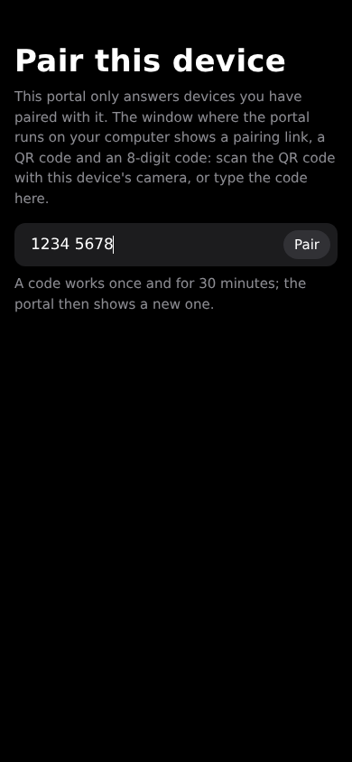
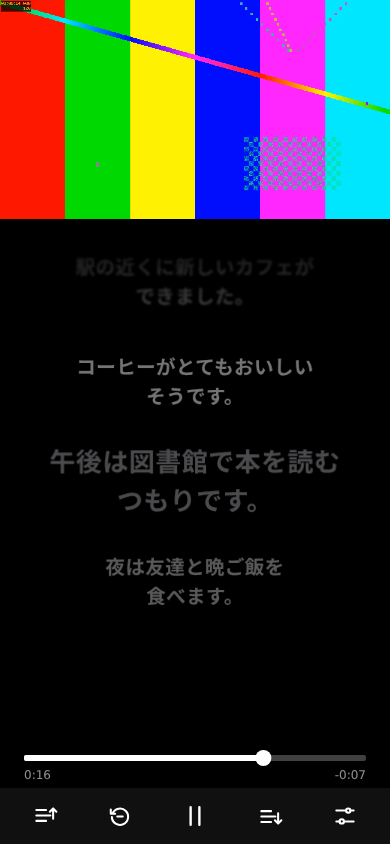

# The phone portal

`portal/` serves a phone-sized web page from the computer that runs the server: a YouTube video
in the page's own player, Shisu-ko's cues as a scrolling list with a word-by-word highlight,
dictionary lookups through the Yomitan API, and one-tap mining into Anki. It is a separate process
with no state of its own beyond `~/.shisu-ko/portal-state.json`; everything else it composes from
services that already run on the computer.

```
phone browser ──HTTP──► portal/portal.py (127.0.0.1 / LAN / Tailscale, port 8791)
                          ├─► Shisu-ko server  127.0.0.1:8790  /sync (cues, words, the deck's rows), /clip (sentence audio), /health
                          ├─► Yomitan API      127.0.0.1:19633 /tokenize, /termEntries, /ankiFields (fields, word audio)
                          ├─► AnkiConnect      127.0.0.1:8765  deckNames, modelNames, modelFieldNames, canAddNotes, storeMediaFile, addNote, sync
                          ├─► yt-dlp (in-process)              YouTube's HLS stream, proxied
                          ├─► YouTube (--watch-history on)     playback and watch-time pings, the viewer's cookies
                          └─► PyAV (in-process)                the card's picture, cut from an HLS segment
```

Files: `portal/portal.py` (the server; stdlib plus yt-dlp and PyAV, imported lazily), `portal/qr.py`
(a small QR encoder for the pairing code), `portal/static/` (the page: `index.html`, `app.js`,
`app.css`; `lib.js` holds its pure helpers and every UI string; `pair.html`, `pair.js` the pairing
page; `/words.js` is the extension's `addon/words.js`, served from the checkout), `portal/tests/`. Launchers: `server/portal.cmd`, `server/portal.sh`, `nix run .#portal`. They
run the server's own Python environment (`~/.shisu-ko/venv`), which has yt-dlp and PyAV.

## Who may use it

Three access modes, chosen at start (`--mode`, or `PORTAL_MODE`):

| Mode | Listens on | Who gets an answer |
|---|---|---|
| `local` (default) | 127.0.0.1 | this computer only |
| `lan` | 127.0.0.1 and the LAN address (`--host` to choose; 0.0.0.0 allowed) | loopback, and devices holding a paired token |
| `tailscale` | 127.0.0.1 and `tailscale ip -4` | loopback, the tailnet devices of this computer's own Tailscale user (`tailscale status --json`), and paired devices |

`check_binds()` refuses an address that does not fit the mode: a LAN or wildcard address in local
mode, a non-Tailscale address in tailscale mode. Only lan mode, where every device must pair, may
listen on 0.0.0.0.

**Pairing (lan mode).** At start, and again after each pairing or when a code expires, the portal
prints a one-time link with a 192-bit secret, the same link as a QR code (`qr.py`), and an
8-digit code. A code works once and for 30 minutes. `GET /pair?code=` (the link) and
`POST /api/pair` (the typed code) exchange it for a device token: 256 random bits in an `HttpOnly`,
`SameSite=Strict` cookie for 400 days. Only its SHA-256 is stored (`devices` in
`portal-state.json`, with a name from the User-Agent and when it was last seen). Both pairing paths
are rate-limited: 10 tries a minute per address, 60 in all. The typed code exists because an
iPhone home-screen app keeps cookies apart from Safari, so a device paired in Safari is not paired
in the installed app. Settings lists the devices and forgets one (`POST /api/devices/forget`);
`--forget-devices` forgets every device.



**On every request**, in this order: the `Host` header must name this computer (a bind address,
localhost, its host name or `<host>.local`, its Tailscale name or addresses, or a `--host-name`);
this stops DNS rebinding. Then `authorize()`: loopback, a valid device token, or (tailscale mode)
an owner address. A refused page in lan mode is the pairing page (401); a refused API call is a 401
or 403 in JSON. Only `/pair`, `/api/pair` and the files the pairing page needs (`app.css`,
`pair.js`, the icons, the manifest) are open without a token, and those still need the Host check.
POSTs must be `application/json` and carry no foreign `Origin`, so a page on another site that the
phone visits cannot drive the portal (CSRF): it cannot send that type without a CORS preflight,
which the portal never grants, and the device cookie is `SameSite=Strict` besides.

**Threat model.** The portal assumes the computer and its user are trusted, and so are the services
on loopback. It defends against other devices on the same network (lan mode: no token, no answer),
against other people on a shared tailnet (tailscale mode: owner check), and against web pages the
phone visits (Host, Origin, JSON-only, SameSite). Traffic is plain HTTP: on a LAN anyone who can
read the network can read the pages and steal a device token; Tailscale encrypts its traffic. The
portal never proxies a URL a client names: video URLs are resolved on the computer by yt-dlp, and
the client only ever sees opaque tokens (below); the watch-history pings go only to the tracking
URLs in YouTube's own player response. Video IDs are checked against
`^[A-Za-z0-9_-]{6,20}$`; request bodies are capped at 64 KB; every upstream call has a timeout.

## The card

Which deck and note type a word goes to, and what each field holds, is set up in the page
(Settings > Anki), stored as `card` in `portal-state.json`. `~/.shisu-ko/portal.json`, when
present, overrides any of its keys (`deck`, `note_model`, `tags`, `duplicate_scope`, `fields`,
`first_field`, `sentence_field`, `default_gloss_dictionary`); the page then
shows those choices as fixed. `validate_card()` checks both; an unknown key or a bad value in the file stops the portal at
start with the reason. There are no built-in defaults: until a deck, a note type and its fields are
set, the home screen says so and the first Mine opens the setup.

A field's value is a template: Yomitan markers (`{expression}`, `{reading}`, `{glossary}`,
`{audio}`, ... rendered through the Yomitan API's `/ankiFields` with Yomitan's current profile),
and the portal's own:

| Marker | Value |
|---|---|
| `{cloze-prefix}<b>{cloze-body}</b>{cloze-suffix}` | the cue's text, the tapped word in bold (all HTML-escaped) |
| `{portal-sentence}` | the cue's text |
| `{portal-picture}` | `` of the frame at the cue (start + min(0.75 s, half the cue)) |
| `{portal-sentence-audio}` | `[sound:]` of the server's `/clip` for the cue's start..end |
| `{popup-selection-text}` | the definition picked in the sheet, else the first gloss of `default_gloss_dictionary` (or of the first dictionary) |

`guess_fields()` proposes a mapping from the field names, case-insensitively and in a few
languages: Picture/Image/Screenshot get the picture, SentenceAudio the sentence audio (the
extension's own defaults, `ankiImageField: "Picture"` and `ankiAudioField: "SentenceAudio"` in
`addon/settings.js`, so both tools fill the same fields), Sentence the bold sentence, Audio the word
audio, Reading, Furigana, Pitch, Frequency, Definition/Meaning/Glossary, and the word for
Word/Expression/Front or, failing all, the first field (Anki's duplicate check compares it). The
picture and the sentence audio are fetched only when a field uses them.

Media files are named like the server's mined ones: `shisuko_<video>_<start ms>.jpg` / `.mp3`.
The server's own miner (`mining.md`) leaves the portal's notes alone: they arrive with their picture
and audio, and the portal's `/sync` carries no `anki` settings, so its sessions are never mined for.

## The video: an HLS proxy

The page plays the video in its own `<video playsinline>` (no YouTube UI at all). yt-dlp resolves
YouTube's HLS master playlist on the computer; googlevideo URLs only work from the address that
resolved them, so the portal proxies every byte:

- `rewrite_master()` keeps H.264 variants up to 720p, best first (where iOS starts), with the AAC-LC
  audio rendition, and rewrites their URIs to `/api/hls/<token>/<key>.m3u8`; `rewrite_media()`
  rewrites each segment to `/api/hls/<token>/<key>/<n>.ts` (video, MPEG-TS) or `.aac` (audio:
  YouTube's audio renditions are packed ADTS AAC with ID3 timestamps, not TS, and a player picks its
  demuxer by the name). No upstream URL ever reaches the page.
- The stream resolves without cookies first. With the server's YouTube cookies yt-dlp asks only
  the YouTube clients that take cookies, and those offer no HLS, so every video would fall back to
  YouTube's player. The cookies are the second try, for a video that needs a sign-in (members-only,
  age, a bot check) or that gave no HLS anonymously. When the anonymous try found no HLS and the
  signed-in one fails, the answer is still that 422, which sends the page to YouTube's player.
  googlevideo binds its URLs to the address, not the account. The picture's DASH fallback (`stream_url()`) keeps the cookies: it needs no HLS.
- The token is random and names a video the portal resolved itself; it expires after 8 hours, or 2
  idle. A 403 from googlevideo re-resolves the stream under the same token, so the player never
  notices; network errors and 5xx retry with backoff.
- Segments are fetched when a player asks for them, so a paused or closed player costs nothing; the
  last 64 MB stay in memory, for re-requests and for `Range`. HTTP/1.1 keep-alive carries the
  hundreds of segment requests.
- `/api/media?video_id=&t=` resolves the stream (about 2 s) and pre-fetches the playlists and the
  segments at the start time, so a tap plays in about 0.2 s.
- The card's picture is cut with PyAV (`frame_jpeg()`, `encode_jpeg()`: decode the segment the
  phone played, encode with PyAV's own MJPEG encoder; no ffmpeg binary, no Pillow), falling back to a
  DASH stream URL when the video was not streamed through the portal.
- Live streams, a stream that cannot be resolved, yt-dlp missing, a browser without native HLS
  (desktop Firefox) or a playback error fall back to YouTube's iframe player; Settings then says
  "Using YouTube's player". That player still draws a title row and a play/pause glyph whatever
  `controls=` says; the page renders it at three times the box size, scaled down, inside a taller
  clipped frame, so most of it falls outside the picture.

Every resume (Mine, closing the sheet, the toolbar, a tap on the video) calls `play()`
synchronously inside the tap, for iOS's rule that sound may only start inside a user gesture.

A tap on a word pauses (Settings > Pause when looking up a word) and keeps the playhead of the
tap. The tap lands a second or more after the words that prompted it, so closing the sheet always
seeks back before it plays (`lookupResume()`): by default one second before the tap, never before
the line's start; with Settings > Resume after a lookup > Start of the line, to the line's start.
The line is the tapped word's when it is the line being said or the one before it, else the line
being said. Before the first line (an intro, or a tap on the line still to come) there is no line:
both settings resume one second before the tap, never at 0:00 unless the tap was within that
second. Auto-pause skips that line's end once. A sheet opened while paused resumes nothing, and one closed
without resuming (the Anki setup opening over it) leaves the playhead where it paused; a resume
already at its target does not seek.

## The YouTube watch history

Off by default. With `--watch-history on`, a video played in the portal's own player counts on the
viewer's YouTube account: it lands in the watch history, and the recommendations see the time
actually watched. The account is the one signed in to the browser whose cookies the server sends
(`cookies_from_browser` in `config.json`, `cookies_browser()`). Without such a browser, or in the
container (`SHISUKO_CONTAINER`), the switch does nothing and the log says why at start;
`/api/info`'s `watch_history` tells the page `"on"`, `"off"` or `"no-cookies"`, and Settings >
Server says it in one line (`watchHistoryText()`).

What leaves the computer, all of it to YouTube under the viewer's account, and none of it unless
the switch is on and a cookie browser is set: one signed-in extraction per video (tried again
after a failure), the playback ping once per viewing, and a watch-time ping per report (below).
Each ping carries the base URL's own parameters, a random `cpn`, the stretches played (`st`,
`et`), `cmt`, `len`, `state`, `rt` and its derivatives, `final` at the end of a viewing, the
response's client (`c`, `cver`, `cr`), the phone's browser and system (`cbr`, `cbrver`, `cos`,
`cosver`), `lact`, `volume`, `muted`, `fmt`, `afmt`, and fixed values (`ver`, `el`, `cplayer`,
`fs`, `euri`, `vis`, `idpj`, `ldpj`), sent with the browser's YouTube cookies and
`X-Goog-AuthUser: 0`. The README and `docs/amo/privacy-policy.md` state the same; a change here
changes them too.

- **What is captured.** The tracking URLs must come from a signed-in player response: that is
  what ties a ping to the account. The stream resolves anonymously (above), so after it
  `start_tracking()` runs one signed-in extraction per video on a thread of its own
  (`fetch_tracking()`, `process=False`; never two at once, and none when the resolve itself went
  signed in: its answer is the one that extraction would get, so no URLs there means none, logged
  once). `capture_tracking()` replaces `mark_watched` on that `YoutubeDL`'s own YouTube
  extractor instance; yt-dlp calls it with the player responses it fetched, and the override keeps
  the first response's `playbackTracking` base URLs (`videostatsPlaybackUrl`,
  `videostatsWatchtimeUrl`; `https` on a YouTube host only, `tracking_urls()`) on the `HlsVideo`
  and sends nothing. The response names `s.youtube.com`; `stats_host()` moves exactly that host to
  `www.youtube.com`, where YouTube.js and ReVanced send theirs, and keeps the rest of the URL. With
  the URLs go the web player's flush schedule (`flush_cadence()`):
  `videostatsScheduledFlushWalltimeSeconds` (a WEB response says 10, 20, 30) and
  `videostatsDefaultFlushIntervalSeconds` (40). A schedule of 1-10 rising steps at least 2 s apart
  and within 600 s is kept; anything else, or a response without one, gets those WEB values. Playback never waits for it. A failed look-up is logged once per video
  and tried again on a later report, once its backoff has passed (`TRACKING_RETRY`: 30 s, 2 min,
  then every 10 min; `tracking_pending()`, called from `Services.watched()`), so only a video that
  is being watched is looked up again.
- **What the page sends.** Our own `<video>` keeps the stretches it played (`newWatchLog()`,
  `watchAt()`, `watchClose()`, `watchDrain()` in `lib.js`): a seek, pause, rate change, the end or
  a jump of over 3 s closes one. `POST /api/watched` carries `{video_id, ranges: [[st, et], ...],
  cmt, duration, state: "playing" | "paused", final}` on YouTube's schedule: 10 s after play
  starts, then after the playing time the answer's `next` names (seconds; `watchNextMs()`); at a
  pause (the viewer's, auto-pause, a lookup, a scrub) with `state: "paused"`; and with
  `final: true` only where a viewing ends, as YouTube's player sends it: the end of the video, the
  page hidden or left, home, and the switch to YouTube's player (keepalive). The server counts the
  reports that are not final and answers each with the step to the next one, 10, 10, then 40 s
  for a WEB response; a final report does not advance it. A resume after a pause or a final
  report starts the next step afresh; a stall does not. Without an answer the page reports again
  after 40 s. YouTube's iframe player records its own watches,
  so the page sends nothing from it. With them go, each optional: `lact` (ms since the last touch
  or key on the page), `volume` (0-100), `muted`, and `client: {browser, browser_version, os,
  os_version}`, read from the User-Agent (`clientInfo()`). `parse_watch_report()` refuses (400) a
  bad video id, more than 20 ranges, a number that is not finite, any time outside 0..duration +
  5 s, a `final` that is not a boolean, and a client string beyond 1-32 of `[A-Za-z0-9._ -]`.
- **What goes to YouTube.** `WatchReporter` keeps one session per video (a random 16-character
  `cpn`, dropped after 2 idle hours; the playback ping and every watch-time ping carry the same
  one). The first played time sends the playback ping once (`ver=2`, `cpn`, `cmt`,
  `el=detailpage`), which adds the video to the history. Then a watch-time ping per report, at
  most one per video every 10 s (or the schedule's shortest step, if that is shorter:
  `WatchSession.gap()`), the stretches in between merged. A final report's ping goes as soon as
  2 s have passed since the last ping, with `final=1`, as SmartTube, YouTube.js and Grayjay end a
  viewing; a later report in the same session continues it with the same `cpn`, and the last
  report decides whether the next ping is final. The watch-time ping carries `st` and `et` as
  comma-separated lists with 3 decimals, as YouTube's own player sends them, plus `cmt`, `len`,
  `state` and `rt` (seconds since the session began). The base URL's own parameters stay.
  Both pings carry the client context YouTube's web player sends (`WatchSession.context()`), never
  a made-up value: `c`, `cver` from the signed-in response's CSI tracking params and `cr` from its
  GFEEDBACK `ipcc` (`response_client()`, captured with the URLs); `cplayer=UNIPLAYER`, `fs=0`, an
  empty `euri`; the page's `cbr`, `cbrver`, `cos`, `cosver` and `lact`; `fmt` and `afmt`, the
  itags of the variants the player last took a segment from. The watch-time ping adds `rti`
  (whole seconds of `rt`), `rtn` (`rti` + 10, as the web player's early pings carry), `idpj=-1`,
  `ldpj=-1`, and `vis=0`, `volume`, `muted` with one value per stretch, as `st` and `et`. `hl` is
  left out: the response does not say it. The
  pings run on a thread of their own through a `YoutubeDL`'s `urlopen` with the server's cookies
  (one `YoutubeDL` an hour, so the browser's cookie store is not read for every ping) and the
  header `X-Goog-AuthUser: 0`, the account the cookies sign in first, as Grayjay sends it (a brand
  account's `X-Goog-PageId` is left out: the response does not say it); a failure is
  logged once per video and never touches playback. Stretches reported while the signed-in look-up
  runs, or while a failed one waits for its retry, wait in the session and go with the first ping
  after the URLs arrive (`set_tracking()`). A video with no tracking URLs and no look-up to come
  (resolved before the switch, a signed-in resolve whose answer carried none) reports nothing.
- **What YouTube makes of it.** Every ping answers 204 and puts the video in the history. On the
  owner's account a 23-minute video's history bar showed the position of a watch-time ping (34%,
  `cmt` 481 of 1397) before `www` and `final=1` were sent; it did not follow the later pings.
  Videos under about 20 minutes show a 10% bar, YouTube's "started" placeholder, whatever the pings
  say: yt-dlp, SmartTube and YouTube.js see the same, so it is YouTube's limit on clients other than
  its own, not ours. Positions on long videos are credited; whether `final=1` makes the last one
  stick is unverified.
- **Why not yt-dlp's `mark_watched`.** It sends both pings at resolve, the watch-time one with
  `st=0` and `et` at the end: a whole video claimed watched the moment a link opens. The history
  would fill with videos opened and closed, and the recommendations would learn from time never
  watched.

## Cues, timing and language

The page heartbeats the server's `/sync` (every second while playing, every 5 s paused), always
naming the model the server already holds, so it never asks for a model switch. The proxy sends
`"words": true`, the server's opt-in for Whisper's word timings per cue (`words: [{start, end,
text}]`, and `src`, which the page ignores); a server without it sends none. A line from the
creator's subtitles carries the line's own tokens there, timed from Whisper, or no words at all when
it kept the track's times.

The subtitle list highlights each word as it is spoken (`lib.js`): with `words`, a token takes the
time of the word holding its first character, interpolated inside a word that a token starts in the
middle of; otherwise an estimate, which for Japanese spreads the cue over its tokens by mora count
(from the Yomitan reading) with pauses for 、 and 。, and for any other language evenly by letters.
The clock is the presented frame's time (`requestVideoFrameCallback`) of our own player, or
YouTube's reported time run on at the playback rate for the iframe.

The server's language (`/health`, through `/api/info`) decides the Japanese-only parts: furigana,
the mora estimate and Japanese fonts. Lines are tokenised by Yomitan (`/tokenize`); a language it
has no dictionaries for comes back without headwords, and the page splits the line itself with
`Intl.Segmenter` (or runs of letters). When Yomitan is down, Japanese lines become tappable per
character.

A tap on a Japanese word looks up the text from the character under the finger on (12 characters),
as Yomitan's own scan does, so a token the parser started early (a particle or an expression glued
on: 雨が降っています is one token) costs nothing: a tap on 降 looks up 降る. The longest match
becomes the span, which the list lights and the card's cloze bolds.

Every match is a choice. `compact_entries()` answers the entries that matched the most of the text
first, in Yomitan's order, then the shorter ones (降っています: the readings of 降る, then 降って,
then 降), one per headword and reading, up to `LOOKUP_ENTRIES` (12), each with its own `matched`
length. Every offset between page and server counts UTF-16 code units, JavaScript's own: `matched`
(`utf16_length()`), the mine's span (`build_cloze()`, which refuses half a character), and the
scan, which never ends inside one (`scanText()`), so a kanji beyond the BMP (𠮟) moves nothing. The sheet opens on the first; with two or more, a row of tabs above the definition offers
the rest (`renderCandidates()`, `candidateTabs()`): a divider where the shorter matches start, the
reading only where a term repeats, the picked tab scrolled into view. Picking one shows its
definition, its in-deck state on the Mine button, and narrows or widens the lit span to its match
(`entrySpan()`: the span starts where the tap did), and a mine takes that entry and that span, so
the cloze follows the pick. A token looked up whole (other languages) keeps the token as the span
for its longest matches.

No sheet draws a grabber: a bar that reads as a handle promised a drag the sheets do not need. The
drag down (or right, for the landscape mode's side panels) from content scrolled to the top still closes
one, unmarked (`makeDraggable()`). The visible ways out: a tap anywhere outside the word sheet,
and the backdrop or the round close button in the title row of Settings and the Anki setup, a
row above the sheet's scroller, so it never scrolls away. The character is the glyph
whose box (`Range.getBoundingClientRect()`) holds the point, or the nearest (`nearestBox()`); a
tap on furigana picks among its ruby base. Not `caretPositionFromPoint()`: a caret is the nearest
boundary, so the right half of a glyph answered the next one. A span that starts or ends inside a
token is lit exactly with the CSS Highlight API (`::highlight(picked)`), else whole tokens. Other
languages look up the tapped token whole.

The scrubber above the toolbar shows elapsed and remaining time (h:mm:ss only for a video of an
hour or more) and what is loaded. It updates from the frame clock with `transform: scaleX()` on its
fill and the thumb's `translateX()`, and rewrites its labels only when the second changes. A tap
seeks; a drag (pointer capture, so neither the page nor the subtitle list's swipes see it) previews
the cue at the target in the list and seeks, once, on release, which saves the position once. It is
a `role="slider"` with the time in words as `aria-valuetext`; the arrow keys step 5 s. A live
stream shows "LIVE" instead. The list centres its line in the space above it.



## The landscape mode

The button in the player's bottom-right corner (`#btn-full`, the back button's twin, shown when it
shows: paused, ended, or for 3 s after a tap on the video) switches the watch view to a landscape
layout (`enterLandscape()` / `exitLandscape()` in `app.js`, `html.landscape` in `app.css`): the
video fills the view and the line being said sits low on it in a box of its own. While the controls
show, they form one row along the bottom: elapsed time, a thin bar, the time left, then the exit
button (the same corner button, a collapse icon). The line rises above that row while it shows. The
line is the subtitle list itself, so word taps, the sweep, furigana, word colours, the picked-word
highlight and mining work as in the portrait view. It holds the line being said alone; a vertical
drag on it still browses its neighbours, and a horizontal swipe on it steps a line. The dictionary
is a side panel on the right (dragged right to close), and the line moves left out of its way. The
toolbar is hidden; Settings opens from a corner button at the top right (`#btn-corner-settings`,
shown with the controls), as a side panel too, so the caption box stays in sight beside it. A swipe
or browse drag that starts anywhere on the strip the line lies in works, beside the box or in a gap
when no box shows (`bindListGestures()` on the list and, through `onStrip()`, on the video).

**Taps on the video** (`shieldTap()` and `tapZone()` in `lib.js`). These follow YouTube's app, in
both layouts:

| Where | Portrait | Landscape |
|---|---|---|
| Middle (a third in portrait, a fifth in landscape) | plays or pauses at once | plays or pauses at once |
| A side, once | paused: plays at once; playing: pauses 300 ms later, if no second tap came | shows or hides the controls 300 ms later; never pauses |
| A side, twice within 300 ms | steps a line that way | steps a line that way |
| Each further tap in time | one more line | one more line |

A run counts from the line being said when it began, read from the player's own playhead
(`lineNow()`), and each tap lands at `stepTarget()`: back is the line before wherever the playhead
sits in the line (the extension's rule), and the run clamps at the list's ends. The badge on that
side reads the lines really moved, "1 line »" or "« 3 lines", and covers exactly the side zone
(`TAP_MIDDLE`, `sideShare()`). Back on the first line replays that line from its start and
shows no badge, since no line moved; the swipe and the back button do the same. Forward on the
last line seeks nothing and shows no badge.

**Why the step is checked.** On an iPhone (26, home-screen app) a double tap showed the badge
while the line stayed put. WebKitGTK and Chromium seek correctly, so the iPhone's cause is not
reproduced; two weaknesses explain the symptom, and both are closed. First, the playhead was the
last `requestVideoFrameCallback` report plus the time since, trusted over `currentTime`. Safari can
report frames from before a seek right after it; one such report put the clock, the line and the
next step's base back on the old line. Injected into WebKit, that fault reproduces the symptom
exactly: badge shown, line unchanged 1.5 s later, and the next run counted from the wrong line. A
frame report now only refines `currentTime` (`framePlayhead()`: never while seeking, never more
than 0.5 s away). Second, a seek the browser drops is now made again once, a second later, if the
playhead is still more than a second from it (`checkSeek()`), and a playing video is no longer
asked to `play()` again right after the seek.
Play must run inside the tap, because iOS starts sound only within a gesture's own call stack. So a
lone tap that plays does so at once; only a pause, which needs no gesture, waits for the window. A
hidden state holds until the next tap, pause or end. While playing, the controls hide 3 s after the
last tap, and a scrub keeps them up 3 s more. The shield is `touch-action: manipulation`, so a
double tap never zooms. In the landscape mode only the subtitle's box takes taps (`#lyrics` is
`pointer-events: none`, its cues `auto`), so a tap beside the box reaches the video; the video
ignores the click that ends a swipe on the strip.

**The subtitle's look** follows the iPhone's own captions (Settings > Accessibility > Subtitles &
Captioning) and the broadcast guidelines:

- White text on `rgba(0, 0, 0, 0.6)` with rounded corners (0.3em), one box per cue that hugs the
  text. Over a white frame that is 5.7:1, above WCAG AA's 4.5:1. WebKit's `::cue` default is 80%
  black (`text-tracks.css`). One box per cue rather than one per line: an inline box per line
  overlaps its neighbour in darker stripes and leaves furigana outside.
- The size follows the view's height: `clamp(18px, 6.2cqh, 40px)`, with `.watch` as the size
  container. That is the BBC's line height of 7-9% of a 16:9 picture. A line is at most 68% of the
  view wide (the BBC's figure for 16:9 online), so a cue stays within two lines. Netflix allows
  Japanese 13 characters a line, which these cues outgrow.
- The list is bottom-anchored (`focusY()` and `placeTrack()`): a second row and furigana grow
  upward, and the box rests `max(14px + lift, safe bottom)` above the bottom edge. While the controls show
  it glides up above them, `transform` only, 200 ms (none with reduced motion).
- No darkening of the picture beyond the box. A soft shade sits under the controls row only while
  it shows, for the times over a bright frame.
- No `backdrop-filter`: the iPhone's captions are flat, and blurring the video under the box would
  redraw it every frame on the phone.
- On the box, the sweep's unspoken text is `rgba(235, 235, 245, 0.6)` and the picked word's light
  is 0.28, twice the portrait view's. The sweep's glow is off, since it only greys the box.

**Settings > Subtitle style** is a sub-page pushed sideways inside the Settings sheet, with a back
chevron in its title row (`showSettingsPage()`), as iOS Settings does. It sets the landscape box
only; the portrait list keeps its look.

| Setting | Choices (default bold) | Applied as |
|---|---|---|
| Background | None, 30%, 45%, **60%**, 80% | `--cap-bg`, the box's black alpha; below 45% the text gets its own shadow (`--cap-shadow`) |
| Text size | Small, **Medium**, Large | `--cap-scale`: 0.85, 1, 1.2 times each bound of the size clamp |
| Position | Lower, **Default**, Higher | `--cap-lift`: -8, 0, +24 px on the resting height, never below the safe area |

The defaults are today's look. They live with the other settings (`DEFAULTS`, localStorage);
`captionStyle()` turns any stored value that is not a listed choice into the default, and
`captionVars()` hands CSS bare numbers only, clamped, so nothing from storage reaches the
stylesheet as text. Changes apply at once. In the landscape mode the sheet is a side panel and,
while it is open, the line rests over the bare picture (no controls, no pause scrim), so the real
box is the preview. In portrait the page shows a sample box over a stand-in picture. Where the
safe area already holds the box above 14 px (an iPhone with a home indicator, held sideways with
the page unturned), Lower changes nothing.

**The corner buttons** keep 20 px from every physical screen edge and stay inside the safe area
(`--edge-*`, from the turned or plain `--safe-*`). iOS keeps the edges for itself: the status bar,
Control Center's corner, Notification Center's top edge and the home indicator. At 4 px from the
edge, as in 0.26.0, an iPhone's home-screen app took neither button. Real coordinate taps in WebKit
and Chromium, and `elementFromPoint()`, found no page element over them, so the cause lies outside
the page. Both buttons are 44 x 44 px targets, placed absolutely in the player box, not as fixed
elements.

How it gets the whole screen depends on what the browser allows, found by feature detection:

| Browser | Fullscreen | Sideways |
|---|---|---|
| Android, iPad, desktop | `requestFullscreen()` on the whole page (`document.documentElement`), so the sheet and toasts come along | `screen.orientation.lock("landscape")` once fullscreen; a refusal is ignored |
| iPhone (Safari, the home-screen app, every iOS browser) | none: the page fills the viewport (`position: fixed`); the home-screen app has no browser bars, so that is nearly the whole screen | the CSS below |

An iPhone has no element fullscreen: `requestFullscreen()` is iPad-only (MDN's compatibility data,
up to iOS 26), and the one fullscreen it has, `webkitEnterFullscreen()` on a `<video>`, opens
Apple's own player, over which no page content draws. Subtitles we can tap cannot exist there, so
the portal never uses it. Nor can a page lock the orientation on iOS (`lock()` rejects). So while
the mode is on and the viewport is taller than wide (`shouldTurn()`), the page turns itself
(`html.turned`): `body` is sized to the screen the other way round (`100dvh` x `100dvw`) and
rotated a quarter clockwise. The viewer turns the phone, with the rotation lock on or off; a phone
that does rotate the page gets a landscape viewport, and the turn goes away (the window's
`resize`, `orientationchange` and the visual viewport's `resize` meet in one animation frame,
which calls `viewChanged()` only when the window's size changed; a pinch or the keyboard re-lays
nothing). The turned body is the containing block of every fixed
bar, sheet and toast, so they turn with it; percentages in the mode's CSS are of the view, never
`vw`/`vh`, and the safe-area insets are remapped (the notch is the turned view's left).

**Pointers under the turn.** The browser hit-tests through the transform, so a tap lands on the
word drawn under the finger, and `tappedIndex()` compares glyph boxes and the tap in the same
screen coordinates. Only code that reads coordinates as directions needs the view's frame:
`viewPoint()`, `viewDelta()` and `viewRect()` in `lib.js` (screen x is the view's y, measured from
the view's bottom). They map the video's tap zones, the subtitle's swipe and browse drag, the
scrubber's tap and drag, the sheets' drag to close, and `focusY()` / `capSheet()`'s room
measurements, and the match tabs' sideways scroll (`revealTab()`).

**Leaving.** The exit button, the browser's own fullscreen exit (`fullscreenchange`: Android's
back gesture, Escape) and leaving the video by any way (`teardownWatch()`: the back button, the
video's end, a link) all end the mode the same way: the classes go, fullscreen and the orientation
lock are released, and the list is re-anchored on the same cue without motion. The playhead is
never touched. Nothing is remembered: each video starts in portrait. The YouTube iframe fallback
takes the mode as well; the iframe only grows, keeping its 3x-and-crop trick.

## Retries

- The heartbeat never stops. A failed `/sync` backs off 1, 2, 4, 8 ... 15 s with jitter and reads
  "Reconnecting…". An errored session reads "Retrying…", with the server's opt-in `retry_in`
  countdown, and is "Subtitles unavailable" only when the server says `retrying: false`.
- Lookups, tokenising and the in-deck check retry 3 times (300 ms, 900 ms, 2.7 s).
- A mine retries by itself 4 times over about 30 s. Each mine carries a job ID, and the portal
  answers a repeat of a finished job with its first result, so a lost answer never makes a second
  note; an `addNote` retried after an ambiguous failure first looks for a note with the same first
  field and sentence (`add_note_once()`). Duplicates and other 4xx answers are never retried.
- Helpers: `SCHEDULES`, `backoffDelay()`, `isTransient()`, `withRetry()` in `lib.js`; `retry()`,
  `backoff_delay()` in `portal.py`.

## The Anki sync after mining

The portal runs none: the server syncs Anki a minute after a note appears, the portal's included
(`server-runtime.md`, "How the Anki sync after mining works"). Settings > Anki shows the server's
`anki_sync` from its `/health`, read-only: `health()` passes it on under `services.shisuko`, and
`ankiSyncText()` in `lib.js` writes the line ("Anki sync: last 12:04", "Anki sync failed: not
signed in to AnkiWeb", "Anki sync: off on the server", nothing for a server from before 0.21.1).
0.20.0 and 0.21.0 had a scheduler here, a switch and an `auto_sync` key in `portal.json`. A
leftover `auto_sync` is accepted, warned about once at start and ignored (`RETIRED_KEYS`), where
any other unknown key stops the portal; one left in `portal-state.json` is never read.

## Word colours

Settings > Word colours (off by default, like the extension's) underlines each word by the state
of its Anki card, with the extension's own matcher. The server reads the deck: the page's
`/api/sync` carries `deck: {since}`, `portal.py` names the card setup's deck (none: the server's
automatic deck) and the token, and the answer's `deck` brings every row the first time and the
changed rows after that. The page builds words.js's index from them and marks each line, cut into
Yomitan's tokens. The page sends a token only; the deck is the portal's choice. Detail:
`word-colours.md`, "The portal".

## Positions and the home screen

Where each video was left is kept in `portal-state.json` (`positions`), shared by every device:
saved every 5 s while playing, on pause, seek, hide and leaving (never by a torn-down player, which
reads 0). Reopening resumes 2 s before it;
under 10 s, or finished, starts from 0; a `?t=` in the link wins (`resumeTime()`).

**Finished** has one rule, `finished()` in `lib.js`, read by the bar, Mark as watched / unwatched and
the resume: the last tenth of the video, never less than 2 s and never more than 30 s. A long video
is finished in its last 30 s (credits, an outro), a 2-minute one in its last 12 s, a 15-second clip
in its last 2 s rather than a third of it.
The home screen lists them with thumbnails (`/api/thumb/<id>`, cached on the computer) and shows
what is still missing (`/api/health`: the server, Yomitan API, AnkiConnect, yt-dlp, PyAV, and the
card setup), each with what to do.

- **The watch bar** is YouTube's: a translucent grey track flush with the thumbnail's bottom edge,
  3 px here, and the watched part in YouTube's brand red, `#ff0033`, at least 3 px wide. Its length
  is `watchedFraction()`, the position over the duration; a finished video's bar is full. No duration, or a position of 0: no bar.
- **Swipe actions**, as in iOS Mail: a row slides left off Mark as watched and Delete, 80 px a
  slot. Pointer events, so a mouse drags too. A gesture picks its axis after 10 px (`swipeAxis()`);
  the rows are `touch-action: pan-y`, so a vertical one stays the browser's scroll. From there the
  row follows the finger 1:1, past the actions at 0.8, and right of closed on iOS's rubber band
  (`swipeShift()`). Only transforms change during a drag, once per frame; the row's width is read
  at the touch, nothing else is measured. Each action is a row-wide slab sliding in from the right
  edge, so the buttons grow with the drag (`actionOffsets()`), the icon centred in what shows and
  the label fading in. A release follows the finger's speed over its last 100 ms
  (`swipeVelocity()`): 0.4 px/ms or more to the left opens, to the right closes, however short;
  slower, past a third of the actions opens (from open, it must close by a third); past 60% of the
  row deletes (`swipeSettle()`, `SWIPE`), unless the release is that flick to the right, which
  closes first of all, as iOS Mail takes a delete back. Past that point Delete takes the whole width, with a short
  vibration where the browser has one (Android). It springs there in 300 ms on
  `cubic-bezier(0.25, 1, 0.5, 1)`; reduced motion moves it at once. One row is open at a time; a tap
  elsewhere, a scroll of over 10 px or Escape closes it, and that tap opens nothing; a swipe never
  opens the video. Mark as watched sets the position to the end (`/api/position`), so the bar reads
  full; on a finished video it reads Mark as unwatched and sets 0 (`watchedToggle()`). A mark is
  not a watch: it posts `keep_order: true`, so the entry keeps its `updated`, its place in the list
  and its standing against the cap of saved positions. A mark never creates an entry: on a video
  deleted on another device it answers 404, and the page drops the row. A row without
  a duration offers Delete alone. Delete drops the position here and on the computer
  (`/api/position/delete`). Edit's red minus opens the same actions, for the keyboard, a screen
  reader and the mouse.
- **The end returns home.** A video played to its end (`ended`, or YouTube's player's ended state)
  goes home after 1.5 s, its end saved first so the bar there is full. The end is posted once:
  `pause`, `ended` and the way home all save it, and a save of the position posted less than 5 s
  before is skipped (`repeatsSave()`), unless that post failed. A touch, a key, a hidden
  page or an open sheet in that beat keeps the viewer on the video, and a touch or key in it does
  nothing else (`holdEnd()`): the tap on the video does not restart it, so the end stays saved and
  the bar at home stays full. The next tap plays it again from the start, a replay whose position
  is saved as it goes, as on YouTube. A live stream never returns,
  nor does an `ended` more than 2 s short of the duration (`atEnd()`, narrower than finished on
  purpose: an HLS stream may stop a segment early); a scrub to the very end is an end.

`portal-state.json` is written atomically (a temporary file and a rename).

## Tests

```
python -m pytest portal/tests          # pytest; PyAV and numpy for the picture tests (skipped without)
node --test portal/tests/lib.test.js
```

CI runs both on Linux and Windows (`.github/workflows/tests.yml`, job `portal`). The page itself
has no automated browser test; the proof of a change is the page in a 390x844 touch browser.
