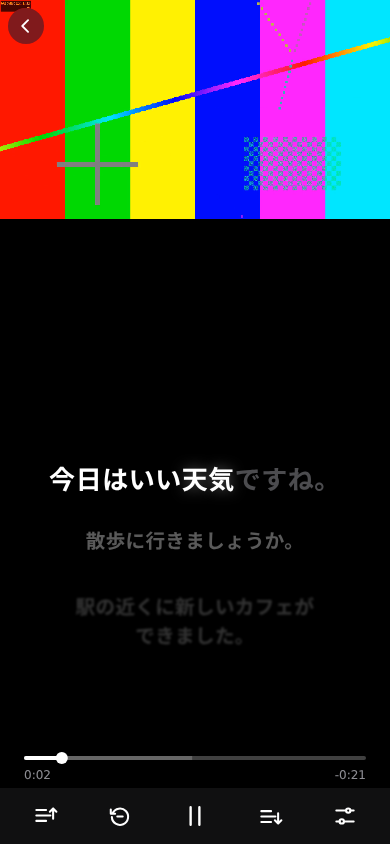
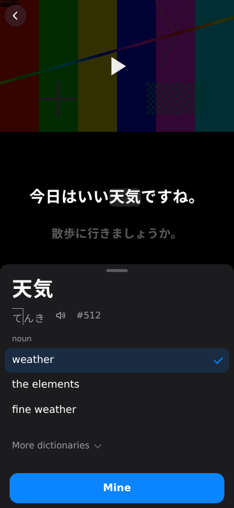
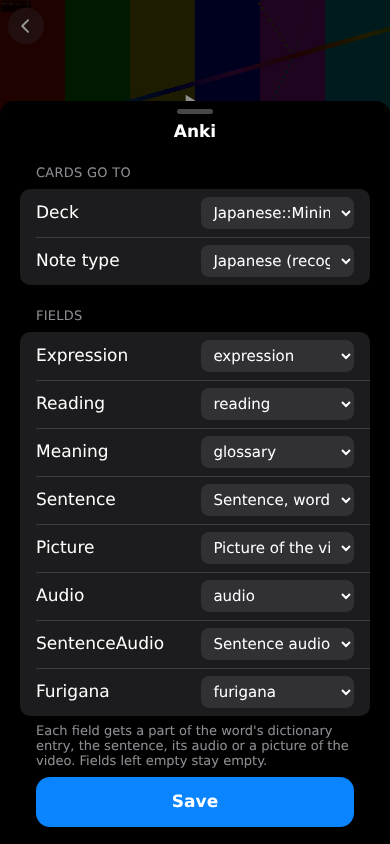
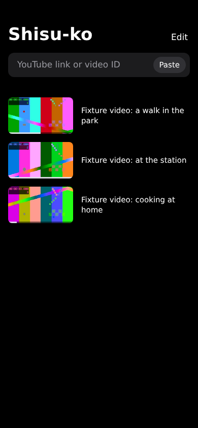

# Shisu-ko phone portal

A phone-sized web page, served by the computer that runs the Shisu-ko server: a YouTube video with
Shisu-ko's subtitles, word lookups through Yomitan, and one-tap mining into Anki.

<p>




</p>

## Setting it up

It uses the services the extension uses, so set those up first: the server, Anki with
AnkiConnect, and Yomitan in a browser on the computer with the
[Yomitan API](https://github.com/yomidevs/yomitan-api) installed (the portal asks it for
dictionary entries and card fields; that browser must stay open). Then start the portal next to the
server. On Windows:

```
server\portal.cmd --mode lan
```

On Linux and macOS:

```
bash server/portal.sh --mode lan
```

With Nix: `nix run github:Multysquid/shisu-ko#portal -- --mode lan` (`nix run .#portal -- --mode lan`
in a checkout).

- `--mode local` (the default) answers this computer only, at `http://127.0.0.1:8791/`.
- `--mode lan` answers phones and tablets on your network, once paired: the portal prints a link,
  a QR code and an 8-digit code. Scan the code with the phone's camera, or open the page and type the
  number. Each device keeps a token; Settings lists the paired devices and forgets any of them, and
  `--forget-devices` forgets them all.
- `--mode tailscale` answers your own devices on your [Tailscale](https://tailscale.com/) network
  (those signed in as the same Tailscale user as the computer), from anywhere.

## Using it on the phone

It needs no app and no extension on the phone: open a page in its browser (or add it to the home
screen). The button in the video's bottom-right corner, shown while paused, turns the phone's
screen into a large landscape player with the line being said along the bottom, still tappable
for lookups.

On the phone, paste a YouTube link. The video plays in the page's own player, streamed through the
computer; the subtitles below it centre the line being said and light up its words as they are
spoken. Drag the bar above the buttons to move through the video; the list shows the line you will land
on. Tap a word for its dictionary entry (the video pauses, and closing the entry plays again from a
second before the tap, or from the line's start: Settings), tap a definition to pick it, and Mine adds the card
with that sentence, its audio and a picture of the video. The first Mine asks which deck and note
type to use, and guesses what each field gets from its name; Settings > Anki changes it. The
server syncs Anki with AnkiWeb a minute after the card appears (see
[Sentence mining](../docs/guide.md#sentence-mining)), and Settings > Anki shows when it last did, or why it could
not. The list of videos remembers how far you got, on every device; swipe a video left to mark it
watched or delete it. A video watched to its end returns you to the list and moves from Up next to
the Watched tab at the bottom, the computer's history of what you finished. How it works, and its security model:
[docs/dev/portal.md](../docs/dev/portal.md).

## Your YouTube watch history

`--watch-history on` (off by default) makes a video you watch in the portal count on your YouTube
account, as if watched on YouTube: it lands in your watch history, and your recommendations see the
time you actually watched. It reports through the YouTube cookies of the browser the server sends
(`--save-cookies-from-browser firefox`; on Windows Chrome and Edge lock their cookies away) and
does nothing without them. It asks YouTube once per video, signed in, for the addresses YouTube's
own player reports to. Then, from your computer and under your account (those cookies, and the
header `X-Goog-AuthUser: 0`), it sends a playback ping when the video first plays, and a
watch-time ping every 10 to 40 s of play, after a pause, and at once when a viewing ends (the end,
the page hidden or left, home, the switch to YouTube's player). Each ping carries a random id for
the viewing; the stretches played, the position and the video's length; whether it plays or is
paused, and the seconds since the viewing began; the phone's browser and system with their
versions (from its User-Agent); the milliseconds since your last touch or key on the page; the
volume and whether it is muted; the video and audio formats playing; the web client and country
YouTube's answer named; and the parameters YouTube put into those addresses itself. Only the
portal's own player reports; YouTube's player, the fallback, records its own. YouTube's
history bar takes the position on videos of about 20 minutes or more; on shorter ones it shows a
10% "started" mark, as it does for every client outside YouTube's own apps.

## Options

Options (`portal.py --help`):

| Option | Default | |
|---|---|---|
| `--mode local\|lan\|tailscale` | `$PORTAL_MODE`, else `local` | who may use it: this computer; paired devices on the network; your own Tailscale devices |
| `--host ADDR` | per mode | address to listen on (repeatable; `$PORTAL_HOST`, comma-separated) |
| `--port N` | `$PORTAL_PORT`, else 8791 | |
| `--host-name NAME` | | another name the page may be reached by (repeatable) |
| `--forget-devices` | | revoke every paired device, then exit |
| `--watch-history on\|off` | `off` | report what you watch in the portal's own player to your YouTube history, through the server's YouTube cookies |
| `--config PATH` | `~/.shisu-ko/portal.json` | card settings that override the page's (optional) |
| `--server`, `--yomitan`, `--anki` | `127.0.0.1:8790`, `:19633`, `:8765` | where the services are |

A `portal.json` that fixes the card setup, for example:

```json
{
  "deck": "Japanese::Mining",
  "note_model": "Basic",
  "fields": { "Front": "{expression}", "Back": "{glossary}" }
}
```

Settings > Word colours underlines each word by its Anki card (the card setup's deck), with the
extension's own matcher; the Shisu-ko server reads the deck.

The Shisu-ko server, not the portal, syncs Anki with AnkiWeb after mining; Settings > Anki shows
how its last sync went. An `"auto_sync"` key left from 0.20.0 or 0.21.0 is ignored, with a warning
at start.
